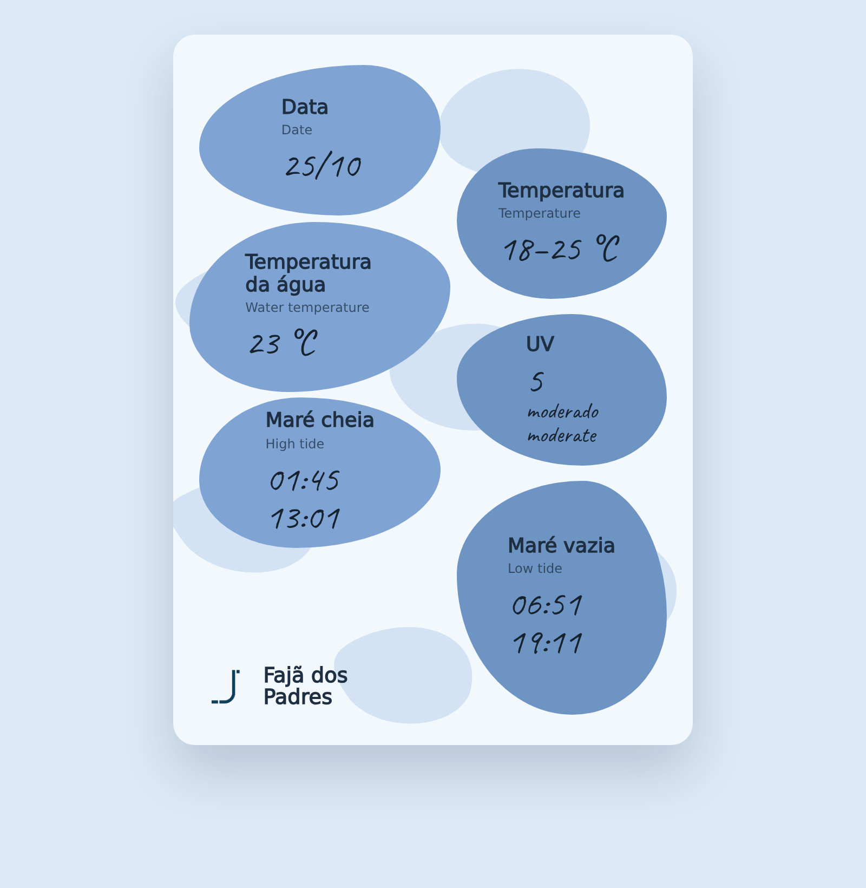
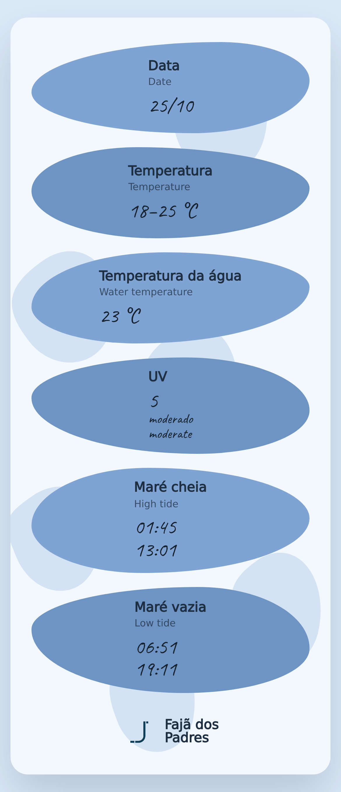
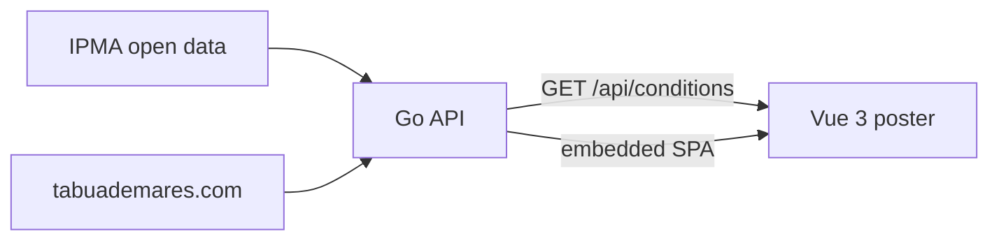

# Fajã dos Padres — daily conditions board

[](https://github.com/Coder266/faja-app/actions/workflows/ci.yml)
[](https://faja-app.onrender.com)

A live recreation of the hand-written daily conditions poster at
[Fajã dos Padres](https://fajadospadres.com/), Madeira: date, air temperature,
water temperature, UV index, and high/low tide times.

**[Live demo →](https://faja-app.onrender.com)**<br>
_Render's free tier sleeps when idle, so the first load can take 10–15 seconds._

<p align="center">
  
  
</p>

## What it does

The physical poster at the beach is updated by hand every morning. This app
replaces it with live data from two sources:

- **IPMA** open data for Funchal: daily air temperature, UV index, and
  sea-surface temperature for the Madeira south coast.
- **tabuademares.com** for today's high and low tide times (IPMA does not
  publish tides).

A Go service aggregates both sources concurrently and exposes a single
`GET /api/conditions` endpoint. The response is cached in memory for 30
minutes and rolls over at midnight in `Atlantic/Madeira`. A partial upstream
failure nulls only the affected field; the rest of the poster still renders.

The frontend is a Vue 3 + TypeScript poster with bilingual PT/EN labels,
handwritten-style values, a responsive layout, loading/error states, and an
automatic retry when data is unavailable.

## Why I built it

I saw the laminated poster at Fajã dos Padres and wanted to see whether a
hand-written daily board could become a live, self-updating page. It also
became a testbed for defensive HTML scraping, fixture-based tests, in-memory
caching, and single-binary deployment.

## Stack

- **Backend:** Go (`net/http`), IPMA client, HTML tide parser, in-memory cache
- **Frontend:** Vue 3, TypeScript, Vite
- **Delivery:** single binary with the SPA embedded via `go:embed`; Docker
  image; Render blueprint (`render.yaml`)

## Run locally

```bash
make dev     # API on :8080 + Vite on :5174
make check   # gofmt, go vet, go test, frontend type-check
make lint    # frontend lint
make build   # build the single binary into backend/backend
make run     # build and serve everything on :8080
```

The project is set up for the devcontainer in `.devcontainer/` (Go + Node +
Playwright), but the commands above work on any machine with Go 1.26+ and
Node 22+.

## Tests

```bash
make test         # Go tests
make type-check   # frontend TypeScript
make lint         # frontend lint
```

Backend tests use fixtures under `backend/*/testdata/` and never hit the live
network. CI runs these checks plus the frontend linter on every push and pull
request.

## How it fits together



## Data sources

- [IPMA open data](https://www.ipma.pt/pt/opendata/) — air temperature, UV
  index, sea-surface temperature.
- [tabuademares.com](https://tabuademares.com/pt/madeira/funchal) — tide
  times, parsed defensively from the public table.

Tide times are cached for 6+ hours, and requests send a descriptive
User-Agent. If the page markup changes, the tide block shows `—` instead of
breaking the poster.

## Reference

[`docs/reference-poster.jpg`](docs/reference-poster.jpg) is the original
laminated poster this app recreates.

## License

MIT
